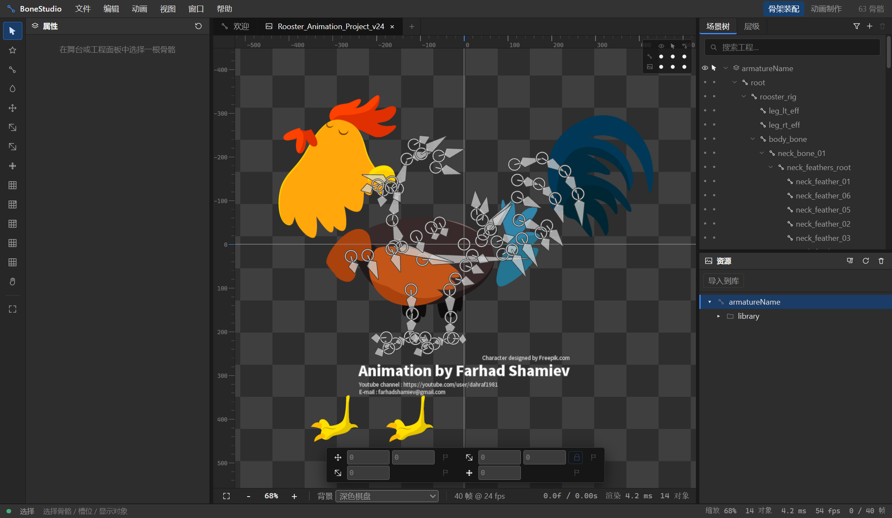
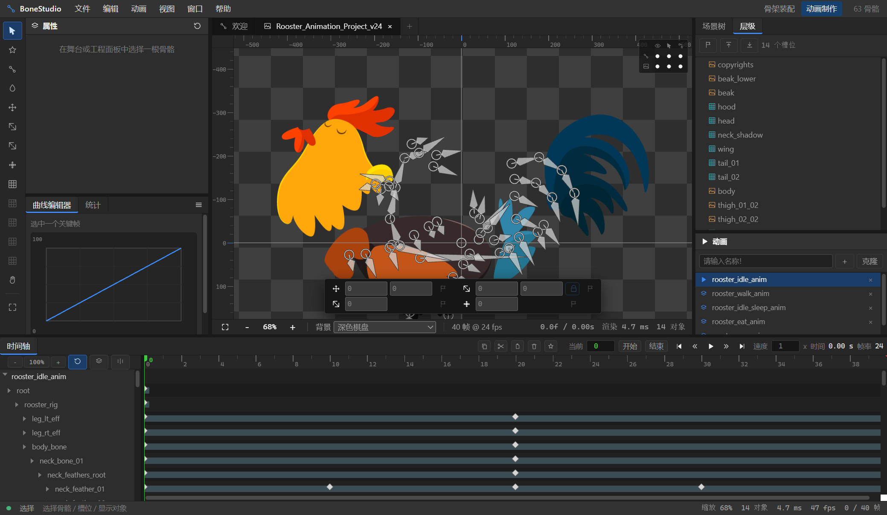

# BoneStudio

在浏览器里编辑 2D 骨骼动画。读写 DragonBones 5.x 工程与 `.dbbin` 二进制，导入 Spine 4.1 / 4.2。

[](LICENSE)

> 本项目是独立实现，与 DragonBones、Egret 及其维护方无任何关联或背书关系。
> 仓库内**不含**任何官方源码、官方运行时、官方示例工程或反编译产物；
> 格式支持依据公开的 MIT 开源实现与公开发布的格式文档，见 [`docs/OSS-REFERENCES.md`](docs/OSS-REFERENCES.md)。

## 界面





## 特性

**解析与播放**

- DragonBones 5.x `*_ske.json` / `*_tex.json`，Spine `.atlas`
- 骨架求值：父子变换、继承语义（`inheritTranslation/Rotation/Scale/Reflection`）、动画采样（线性 / 二次缓动 / 贝塞尔曲线 / 阶梯）
- 网格渲染：贴图四边形、三角网格、**CPU 线性混合蒙皮（LBS）**、FFD 网格变形
- Surface 骨骼（可形变顶点网格）：运行期形变与锚定骨骼继承
- IK 约束：单骨瞄准、双骨余弦定理求解 + `bendPositive` 膝肘方向，支持 IK 时间轴
- 动作帧（`animation.frame`）、权重绘制、Z 序编辑

**编辑器**

- 菜单栏 + 工作区预设、工具选项栏、停靠面板、文档标签、时间轴停靠区
- 时间轴编辑：打 / 删关键帧、摄影表缩放、关键帧多选（框选 / 拖动 / 缩放重定时 / 复制粘贴）
- 骨骼编辑：两点画骨、删除（子骨骼与槽位自动重挂）、改父级（保持绑定姿态、拒绝成环）
- 撤销 / 重做（快照式，最多 60 步）、自动保存与崩溃恢复
- `.dbbin` 二进制读写：容器、稀疏 JSON、七段数组、曲线采样表、权重烘焙偏移与对齐填充

## 快速开始

```bash
npm install
npm run dev        # 开发服务器
npm run build      # 生产构建
npm test           # 单元测试
npm run verify     # 全量验证（构建产物 + 预算 + 验收报告）
```

桌面版（Electron）：

```bash
npm run desktop
npm run package:desktop
```

MCP 服务（把编辑器能力接给 AI 客户端）：

```bash
npm run build:mcp
npm run mcp
```

## 架构

```
src/
  core/            # 编辑器内核（纯逻辑，不碰 DOM）
    parse/         #   DragonBones / Spine / dbbin 解析
    export/        #   dbbin / ske.json / spine 导出
    runtime/       #   骨架求值、动画采样、IK、Surface、数学
    project/       #   .dbproj 工程读写（AMF3）
    *Edit.ts       #   骨骼 / 槽位 / 网格 / 权重 / Z 序编辑操作
  render/          # PixiJS v8 渲染层
  ui/              # React 18 界面
  mcp/             # MCP 工具实现
tools/             # 构建、验证、打包脚本
tests/             # Vitest 单元测试
```

数据 / 逻辑 / 渲染三层分离：`core/` 为纯函数，`render/` 只读状态绘制，`ui/` 负责交互。

## 文档

| 文档 | 内容 |
|---|---|
| [`docs/UX-DESIGN.md`](docs/UX-DESIGN.md) | 界面设计规范 |
| [`docs/PACKAGING.md`](docs/PACKAGING.md) | 打包形态、性能预算、产物验证 |
| [`docs/MCP.md`](docs/MCP.md) | MCP 服务与环境变量 |
| [`docs/SKILL-bone-studio-mcp.md`](docs/SKILL-bone-studio-mcp.md) | AI 客户端接入指引 |
| [`docs/OSS-REFERENCES.md`](docs/OSS-REFERENCES.md) | 参考的开源实现与许可清单 |

## 许可

[MIT](LICENSE)。第三方组件许可见 [`docs/OSS-REFERENCES.md`](docs/OSS-REFERENCES.md)。
