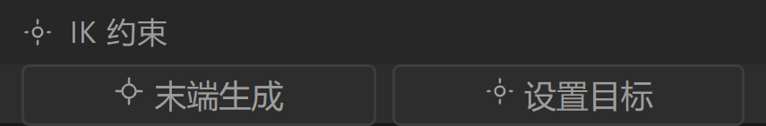
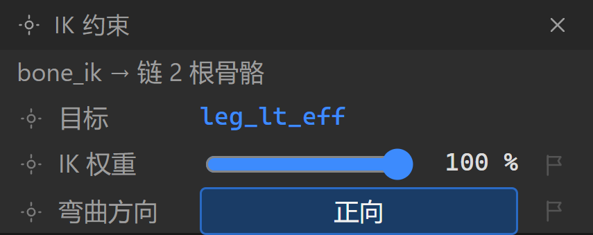
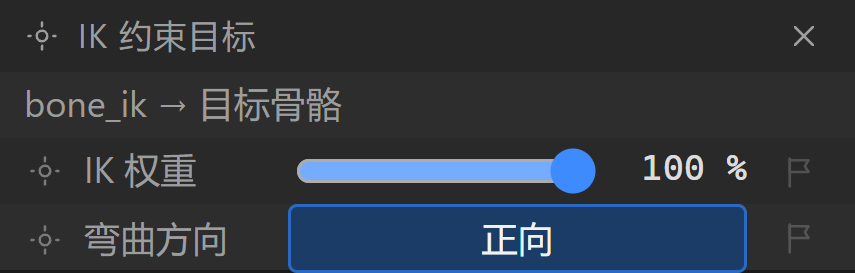
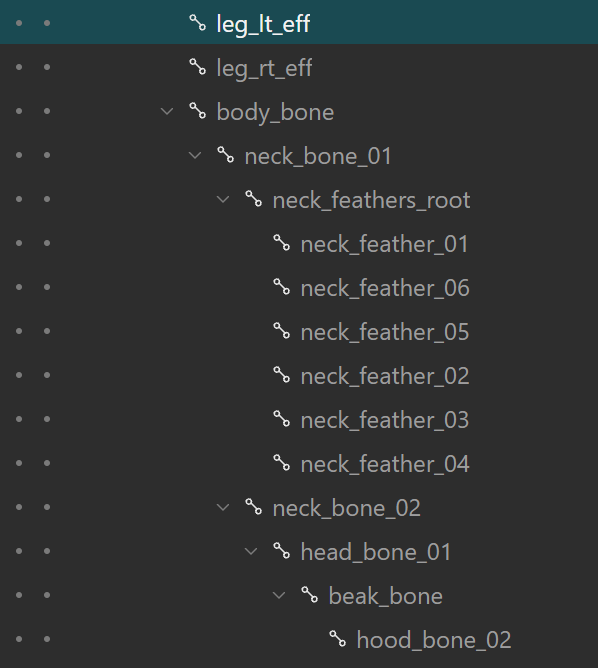

# BoneStudio 界面设计规范（v0.2）

目标：让用过 Adobe 系（Photoshop / After Effects）动画工具的动画师**零学习成本**上手，
同时保留 DragonBones 老用户的肌肉记忆（工具快捷键基本一致）。

视觉语言参考 **ArtCraft 家族**（`storytold/*` 的清洁室 Adobe 复刻系列）：
PhotoCraft（PS）、VectorCraft（AI）、FilmCraft（PR）、LightCraft（LR）、PdfCraft（Acrobat）、
EffectCraft（AE）、DesignCraft（InDesign）。它们的共同点：

| 约定 | ArtCraft 表现 | BoneStudio 采用 |
|---|---|---|
| 顶部菜单栏 | 文件/编辑/…/帮助 + 右侧工作区预设 | 文件/编辑/动画/视图/窗口/帮助 + 默认/动画/网格/专注 |
| 第二行选项栏 | 当前工具的选项与开关 | **已移除**。工具名与提示在状态栏；缩放、100%、适应窗口在舞台页脚、左侧工具列和「视图」菜单 |
| 左侧窄工具栏 | 单列图标工具，单键切换，底部前景/背景色 | 选择/姿态/创建骨骼/权重/移动/旋转/缩放/网格/抓手 + 适应窗口 + 色板 |
| 左停靠面板 | Project 面板：标签页 + 搜索框 + 表头表格 | 工程/资源/信息：搜索 + 名称/类型/关键帧表格（骨骼、槽位） |
| 中央文档区 | 文档标签 + 面包屑 + 视口 + 视口页脚 | 文档标签 + 骨架/动画/骨骼面包屑 + 舞台 + 缩放/帧/渲染耗时页脚 |
| 右停靠面板 | Preview / Properties / 统计 堆叠面板 | 预览（走带+循环+速度+缓存条）/ 属性（变换行+关键帧菱形）/ 统计 |
| 底部时间轴 | 标签页 + 左侧时间码+图层表 + 右侧标尺/轨道条/播放头 | 时间轴/曲线/导出：`30.0f` 时间码 + 轨道表 + 标尺 + 轨道条 + 关键帧菱形 + 播放头 |
| 状态栏 | 左提示 + 右上下文数值 | 工具提示 + 当前骨骼坐标 + 缩放 + 对象数 + 渲染耗时 + FPS + 帧 |

## 设计令牌

```
--bg-app      #1e1e1e   应用底
--bg-doc      #141414   舞台底（比面板更暗，突出画稿）
--bg-panel    #2d2d2d   面板
--bg-header   #333333   面板头 / 菜单 / 状态栏
--bg-input    #1b1b1b   数值与搜索输入
--line        #191919   1px 分隔线（深）
--line-soft   #3d3d3d   控件描边
--text        #dcdcdc   正文
--text-dim    #9d9d9d   次级说明
--accent      #3d8bfd   选中 / 播放头 / 关键帧高亮
--key         #d6d6d6   关键帧菱形
--key-sel     #ffd166   已打关键帧的菱形
轨道条        蓝 #3f5f8f / 红 #8f4a44 / 绿 #4c7a5a / 紫 #7a5a8f
行高 22px · 圆角 3px · 字号 12px（等宽用于时间码与数值）
```

## 组件规范

- **面板头**：26px 高，左图标 + 标题 + 右侧操作按钮（≡ 面板菜单、⟳ 重置、收起）。
- **标签页**：26px 高，激活项底部 2px 蓝色下划线，右侧可放面板级工具。
- **表格**：粘性表头 + 22px 行高 + 斑马纹；数值列右对齐等宽字体。
- **属性行**：`图标 | 标签 | 右对齐数值 | 关键帧菱形`。菱形三种状态：空心（无关键帧）、
  实心黄（该骨骼有关键帧）、实心蓝（当前帧正好有关键帧，点击可删除）。
- **时间轴**：左列时间码 + 轨道表（`#` / 名称 / 父级），右列标尺 + 轨道条 + 菱形 + 播放头；
  左右滚动同步，播放头贯穿整列并在当前帧显示数值。
- **空状态**：视口中央给出「拖入 `*_ske.json` + `*_tex.json` + 图集 PNG」的引导与两个按钮。

## 交互

| 操作 | 行为 |
|---|---|
| 空格 | 播放 / 暂停 |
| Q/W/E/R | 选择 · 姿态 · 创建骨骼 · 权重 |
| Z/X/C | 移动 · 旋转 · 缩放 |
| B/H | 网格编辑 · 抓手（或鼠标中键平移） |
| K | 在当前帧打 / 删关键帧 |
| ← → | 上一帧 / 下一帧（Shift 为上一个 / 下一个关键帧） |
| Ctrl+Z / Ctrl+Shift+Z | 撤销 / 重做（快照式，最多 60 步） |
| F / Home / 滚轮 | 适应窗口 / 回到起点 / 以光标为中心缩放 |
| 舞台点击 | 命中关节（12px）或骨段（7px）选中骨骼 |
| 舞台拖拽 | 移动/姿态工具下拖动选中骨骼，按父级逆矩阵换算后写关键帧 |

## 与 DragonBones 的差异

1. 输出面向 5.x 的 `*_ske.json`，写盘时按 `duration` 累积计算，不引入私有字段。
2. 改数值只更新当前帧已有的关键帧；新关键帧要点属性行右侧的旗标，或按 K。
3. 保留了原工具的快捷键体系，但面板结构向 Photoshop/After Effects 靠拢，降低迁移成本。
4. 所有面板可隐藏（窗口菜单）并提供 4 个预设工作区，含「专注模式」（隐藏两侧与时间轴）。

## 画布背景（Canvas backdrop）

**问题**：原实现把舞台底色设为近黑 `#141414`，与素材里的深色区域冲突——例如 `Rooster_Ani` 的阴影槽位、
深色羽毛会在画面上"消失"，看不出边界。

**调研（参考产品怎么做）**

| 产品 | 画布/背景做法 | 证据 |
|---|---|---|
| **DragonBones（复刻目标）** | 舞台默认是**浅色棋盘**：随程序发布的 `assets/stage/canvasBg.png` 实测为 **16×16、#ffffff + #cccccc 的 8px 棋盘**；另有首选项「背景颜色」「背景网格尺寸」与属性面板的「背景：」 | E1 `assets/stage/canvasBg.png`（sha256 `f8df51424abbd69968c3b20d44584d4292e93b79599f3cf63ff73526db8e693d`，IHDR 16×16 / 8-bit truecolor（type 2）；逐行解 PNG 滤波后 #ffffff ×128 + #cccccc ≈×128，左上 8×8 全白 ⇒ 8px 棋盘）；E2 `Property.canvas.bg`=背景：、`Setting.BGColor`、`Setting.BGSize`、`MenuItem-grid`=背景网格 |
| VectorCraft / PhotoCraft（ArtCraft） | 画板（artboard）居中、四周是**中性灰的背影**；文档自身内容决定画面，透明区域才用棋盘 | E2 参考图（`work/dbrecon/artcraft/vectorcraft-hero.webp` 等）：画布周围为中性灰，面板保持深色 |
| EffectCraft / FilmCraft（AE/PR 复刻） | 合成的背景色是**合成自身属性**（默认可为黑），查看器另有透明棋盘开关 | 参考图：查看器与面板同为深色，合成区域由合成设置决定 |

**结论**：专业工具都不用"编辑器黑"当画布底色——要么是**棋盘（透明）**，要么是**文档/合成自身的背景色**，
编辑器外壳才是深色。BoneStudio 采用同样的分层：

1. **默认 = 官方同款的浅色棋盘**（`#ffffff` / `#cccccc`，16px，8px 格），任何深浅素材都能看清边界。
2. 提供预设：深色棋盘（夜间/浅色素材）、深灰 `#2b2b2b`、中灰 `#808080`、浅灰 `#e6e6e6`、白 `#ffffff`、
   **文档背景色**（读取 `armature.canvas.hasBackground/color`，官方格式字段）。
3. 选择写入 `localStorage`（键 `bonestudio.background`），入口在视口页脚「背景」下拉框。
4. 外壳（菜单/面板/时间轴）仍是深色，画布区域与外壳明确分层。

**实现**：Pixi 画布改为透明（`backgroundAlpha: 0`），画布底色由 `.stage` 的 CSS 背景绘制，
因此切换背景零成本、且不影响导出数据。`pixiRenderer.init()` 的**默认值也已改为透明**（`0x000000, 0`）——即使将来有调用方漏传参数，也不会再退回近黑底。

### 官方舞台网格的精确规格（2026-10-11 补充，来源：官方编辑器文档）

`DragonBones/Loongbones-doc`（Pro 后继产品的**官方**文档站）在 `zh/loongbones/editor/ui-stage.md` 里写明了舞台约定：

> 舞台区，中心是十字表示（0，0）点，**黑白背景格每一个格子的边长表示 100 像素**。

对照本仓库：

| 项 | 官方 | 本仓库 |
|---|---|---|
| 默认背景 | 黑白棋盘（浅色） | 预设「棋盘（官方同款，100px 格）」为默认（深色棋盘作为可选） |
| 格子边长 | **100 px 网格** | 已对齐 100 px（`repeating-conic-gradient(...) 50% / 100px 100px`） |
| 原点标记 | 穿过 (0,0) 的十字参考线 | `StageRenderer.drawOriginCross()`：横竖两条参考线交在世界原点，线宽 1 屏幕像素，随相机缩放/平移 |

> 说明：Pro 随程序发布的 `assets/stage/canvasBg.png` 是把 8px 棋盘**平铺**得到的纹理；
> 官方文档给出的"每格 100 像素"指的是**逻辑网格**（对齐/标尺刻度），两者不冲突：
> 前者是视觉纹理，后者是世界坐标刻度。本仓库用 100 px 的 CSS 棋盘同时承担两者。

### 端到端验收口径（2026-10-11 起）

人工/自动化验收优先走 **Codex 内置浏览器**（in-app Browser）而不是只跑单测：

1. `npm run dev`（本机 5178），`work/dbrecon/samples/manifest.json` 会以 `/dbsamples` 暴露官方样例与本轮新增的
   `Surface_Bin`（Surface oracle 产物）；
2. 深链 `?sample=<名称片段>&frame=<n>&select=<骨骼>` 自动载入；
3. 在页面上核对：骨架树、统计面板的 **「二进制解析」** 行、绘制对象数、FPS、console；
4. DEV 构建同时把解码结果挂到 `window.__boneStudioDecode`，便于脚本/CDP 断言。

### 摄影表（时间轴）缩放与播放头（2026-10-11，对齐官方 dope sheet）

官方 `Loongbones-doc/zh/loongbones/editor/ui-dope-sheet.md` 的口径：

- 「时间标尺有刻度和播放头 —— 刻度单位是帧，**在标尺上点击**可以修改播放头的位置，
  **使用鼠标滚轮可以对标尺进行缩放**」；
- 「时间轴滚动条，当一屏幕显示不下所有的关键帧时出现」；
- 「红色的竖线表示该动画最后一帧的位置」。

本仓库实现与修复：

| 项 | 实现 |
|---|---|
| 播放头 | 位于 `.tl-lanes`（标尺 + 轨道区，唯一定位上下文、`overflow: hidden`）⇒ 永不溢出停靠区；位置 `frame × pxPerFrame − scrollLeft` |
| 缩放 | 标尺滚轮 / 任意轨道区 `Ctrl + 滚轮` / 工具栏 `－ 100% ＋`；范围 25%–4000%；**光标锚定** |
| 刻度 | 主刻度间距 ≥56px、副刻度 ≥3px，元素数有上限（超长动画不炸 DOM） |
| 滚动 | 内容宽 = `帧数 × 每帧像素`；标尺用 `translateX(-scrollLeft)` 与轨道同步 |
| 定位 | 只在**标尺**上按下/拖动才会移动播放头（与官方一致，避免横向滚动误改帧） |
| 末帧 | 红色竖线标出动画最后一帧 |

### 摄影表关键帧编辑（2026-10-11，对齐官方 dope sheet）

官方 `Loongbones-doc/zh/loongbones/editor/ui-dope-sheet.md` 的口径与实现对照：

| 官方描述 | 本仓库实现 |
|---|---|
| 「关键帧可以使用点击或者框选的方法选中」 | 点击关键帧单选；在轨道区拖出选择框（`Shift/Ctrl` 追加）；选中帧高亮为强调色 |
| 「选中的关键帧可以用鼠标拖动来改变关键帧的位置」 | 拖动选中帧整体平移（实时预览 `dragPreview`，松手提交），落在已有帧上会覆盖 |
| 「如果使用框选，可以对框选的关键帧进行缩放……实际是修改了动画的快慢」 | 选择框右边缘出现**缩放柄**（`.tl-selhandle`），左右拖动按比例重定时；锚点 = 选择框最左帧，总时长不变 |
| 「用底部工具栏的复制，剪切，删除按钮」 | 摄影表第二行工具栏：`复制 / 剪切 / 粘贴 / 删除` + 选中计数 + 当前选区帧区间；快捷键 `Ctrl+C/X/V`、`Delete`、`Ctrl+A`（全选） |
| 「时间轴滚动条」（第 21 轮） | 已有：缩放后出现横向滚动条，标尺与轨道同步 |
| 「红色的竖线表示该动画最后一帧」 | 已有 `.tl-endline` |

交互细节：位置对齐整数帧；选区以**帧号**寻址（编辑后仍能跟随）；整组拖动会整体夹取在 `[0, 时长]` 内，
因此相对间距不丢；所有操作都走撤销快照与自动保存（`runKeyEdit` ⇒ `pushHistory` + `modelVersion` + `refresh`）。

### 官方布局对照（2026-10-11，对齐 DragonBones 5.6 主界面）

对照物是目标程序自带工程的真机截图（Rooster 工程）。官方主界面是「四区 + 通栏时间轴」：

| 区域 | 官方 | BoneStudio |
|---|---|---|
| 左上 | 属性（名称 / 类型 / 帧率 / 默认播放 / 画布色） | `.dock.left > .panel`「属性」（骨骼变换，每行右侧旗标手动打帧 + 重置为绑定姿态） |
| 左下 | 曲线编辑器（带刻度网格的曲线视图 + 一行预设按钮） | `.dock.left-bottom`「曲线编辑器 / 统计」标签页 |
| 中间 | 舞台（外框有顶部 / 左侧标尺，底部中央浮着视图控制器） | `.viewer`（顶部 + 左侧标尺，页脚是缩放 / 背景 / 帧信息） |
| 右上 | 场景树 + 绘制顺序（两个页签） | `.dock.right > .dock`「场景树 / 层级」 |
| 右下 | 骨架装配 = 资源库；动画制作 = 动画列表 | `.dock.right > .panel`「资源」（装配）/「动画」（动画），按模式互斥 |
| 底部 | 时间轴通栏（速度 / 时间 / 帧率 + 播放头 / 开始 / 结束 + 运输控制） | `.timeline-dock` 通栏（速度输入 + 帧 / 秒 / 帧率 + `－ 100% ＋` 缩放 + 运输控制） |

各停靠区的实测矩形与本次截图记录在 `docs/evidence/editor-layout.json`，
截图见 `docs/screenshot-editor-layout-curve.png`。

### 舞台标尺（2026-10-11）

官方舞台四周有标尺，用来读世界坐标。实现要点（`src/ui/stageRuler.ts`，纯函数可单测）：

- 标尺条与舞台是同一个 CSS Grid 的两条边（`grid-template-columns: 34px minmax(0,1fr)`、
  `grid-template-rows: 20px minmax(0,1fr)`），左上角是空角块 `.stage-corner`；
- 刻度用**与渲染完全相同的相机映射** `screen = world × scale + pan`，所以标尺读到多少，
  画面里的对象就在那个坐标上；
- 标注步长只取 `1/2/5 × 10^n`（按 `目标像素 ÷ 缩放` 反推），保证任何缩放下标签间距都在可读区间；
  每格再分 5 根副刻度；
- 标签取世界坐标整数值；`0` 刻度使用强调色，和画布中心的原点十字呼应；
- 输入不可用时（缩放 ≤ 0、视口为 0、刻度爆炸）直接返回空数组，不画半张标尺。

### 非阻塞提示（2026-10-11）

官方在动作完成后不会用模态遮住舞台。因此把**瞬时操作结果**从模态对话框改成底部居中的 toast
（`.toast`，`[data-toast]`，2.4 s 自动消失，`pointer-events: none`）：

| 走 toast（不打断） | 走模态（需要读） |
|---|---|
| 已复制 / 已粘贴关键帧、已复制 / 已粘贴曲线、曲线 preset 已应用、已复制变换、组记忆、已导出、已添加 / 已克隆动画、已创建 / 已删除骨骼、权重绘制结果 | 错误与失败原因、快捷键帮助、关于、里程碑占位说明 |

> 副作用修复：模态是全屏 `position: fixed` 遮罩，点过一次「曲线 preset」之后它会吃掉后续所有鼠标事件
> （贝塞尔手柄拖不动）。改成 toast 后手柄拖拽可正常驱动，控制台也不再出现
> `Unable to preventDefault inside passive event listener invocation.`（时间轴缩放改用非 passive 原生
> `wheel` 监听）。


### 槽位属性面板（2026-10-11，对齐官方 `pose-slot.md`）

官方的规则是**面板跟随选择对象**：选中骨骼时属性面板给骨骼变换，选中槽位时给槽位属性。
本仓库沿用同一条规则——`.dock.left > .panel`（左上「属性」）在 `selectedSlot` 非空时
整体切换成槽位属性面板，`selectedBone` 会被清空，避免两套属性混在一起。

| 行 | 控件 | 落盘 |
|---|---|---|
| 名称 | 文本框（回车 / 失焦提交） | `armature.slot[].name` + 皮肤、时间轴、动作帧引用 |
| 挂点骨骼 | 只读 | `armature.slot[].parent` |
| 混合模式 | 下拉（14 项，显示「叠加（add）」= 中文 + 官方英文名） | `armature.slot[].blendMode`（字符串名） |
| 显示资源 | 下拉（`（无）` = `-1` + 当前皮肤的资源名） | `armature.slot[].displayIndex` |
| 颜色 | 色块（点开颜色选择器，R/G/B 0–255） | `color.rM / gM / bM`（`round(channel / 100 * 255)`） |
| 不透明 | 滑条 + 百分比 0–100 | `armature.slot[].color.aM` |

交互与契约：

- 面板顶部 `×` 与分组内的「删除」都走同一条命令（`Delete` 键同样生效）；
- 场景树表头的 `＋` 是官方「创建插槽」：在当前选中**骨骼**下建一个空槽位
  （`displayIndex = -1`，即默认不显示资源），建完后选择自动切到新槽位；
- 改名失败（空名 / 撞名 / 对象不存在）走模态提示，成功走 toast；
- 每次改动都进撤销栈并触发自动保存（与骨骼编辑同一条 `pushHistory` + `refresh` 路径）。

颜色行和不透明行右侧的旗杆只在「动画制作」模式可点。点一下在当前帧打上整份颜色（含不透明），再点一下删掉。骨架装配里旗杆变灰，改色写的是绑定姿态 `slot.color`。动画制作里改色块或滑条会把当前颜色写到播放头这一帧（没有键就补上一帧），舞台上的图片马上变色、变透明。颜色选择器拖动时图跟着变，确定才记入撤销，取消回到打开前的颜色。

IK 组同理：`IK 权重` 是进度条（拖到哪就写哪，右侧百分数同步），`弯曲方向` 是正向 / 反向切换，两行右侧各有一根旗杆 —— 动画制作里点一下打一帧 IK 键（`weight` + `bendPositive` 一起记），再点一下删掉；装配模式里旗杆变灰，改的是绑定数据。

IK 的**两个创建入口只在「还没绑定约束 + 骨架装配」时出现**：「末端生成」（在骨骼末端造一根目标骨骼并建约束）与「设置目标」（鼠标变十字，在舞台上点一根骨骼当目标，直接建约束）。已绑定时这两颗按钮换成属性行，组头只留删除 ×。动画制作模式下它们变灰（官方也是这个门禁）。

**「目标」这一行是可以点的** —— 点它就把选择集切到目标骨骼（同时把场景树展开并滚到那一行），这是官方的「定位」做法（官方没有单独的定位按钮）。选中**目标骨骼自己**时，组标题会变成「IK 约束目标」，并且不再列出「目标」行。









**已做**：官方鼠标悬浮「目标」时舞台上的目标骨骼会高亮（`ROLLOVER_BONE`）—— 这条「面板 → 舞台」的注入通道已经补齐
（`Viewer.externalHover`，见 §114）：场景树的骨骼行 / 插槽行 / 显示对象行 hover 都会点亮舞台上的对应对象，移出即消失。

供自动化断言的稳定钩子：`[data-slot-name]`、`[data-slot-parent]`、`[data-slot-blend]`、
`[data-slot-display]`、`[data-slot-alpha]`、`[data-slot-color]`、`[data-slot-color-flag]`、`[data-slot-alpha-flag]`。

### 结构化编辑后重建运行时（2026-10-11）

`Skeleton` 在构造时派生 `bones` / `slots` / `skinSlots` / `boneIndexByName` 与所有 runtime parent 索引，
所以「改 `armature` 就够」是个陷阱：新建的骨骼/槽位不会出现在大纲与摄影表里，删掉的仍然显示，改名的查不到。
现在所有结构化编辑（增删骨骼、增删槽位、骨骼改名、骨骼改父级、槽位改名）后统一调用
`Player.rebuildSkeleton()`，它保留当前动画名与播放位置。
CDP 实测：创建插槽后大纲行数 14 → 15，`Delete` 后 15 → 14。


### 属性面板的行内动作入口（2026-10-12，替换图片按钮的位置）

**踩到的坑**：`.prop-row` 是**固定 4 列网格**
（`grid-template-columns: 14px 1fr 74px 16px` = 图标 / 标签 / 值 / 行尾 16px 占位）。
往里塞第 5 个元素时它会落进**隐式列** —— 属性面板一窄就被压成一条竖排的
「替 / 换 / 图 / 片」，既难看也读不出意思（用户实测反馈）。

**约定**：属性面板里的**行级文字动作**（目前只有「替换图片」）一律放在**组头右侧**，
用既有的 `.prop-group > .group-head .link` 样式（accent 色、hover 下划线、disabled 变灰）；
**不要塞进 `.prop-row`** —— 那一行的第 4 格只留给 16px 的小标记（`.key-dot` 之类）。

**回归判据**（`work/cdp-swap-layout.mjs`，用元素几何而不是肉眼看）：

| 断言 | 放宽值 | 实测 |
|---|---|---|
| 入口宽度 | ≥ 40px | **46px**（足够放下 4 个汉字） |
| 入口高度 | ≤ 20px（单行） | **16px** |
| 右边界溢出 | ≤ 0 | **-8px** |
| 文字溢出（scrollWidth - clientWidth） | ≤ 1 | **0** |
| 「资源」行的格子数 | = 4 | **4** |
| 点击能开对话框 | true | true |
### 属性行的数值框（2026-10-12，可编辑性要看得出来）

用户反馈「骨骼的长度属性应该可以编辑」。实测下来 `长度` **一直是** `<input type="number">` 且**确实能改**
（`work/cdp-bone-length-ui.mjs`：70 → 93 → 70 都落到 `window.__boneStudio.selectedLength` 上）。
真正的问题是**它看起来不像输入框** —— `.prop-row input` 的边框是 `1px solid transparent`，
在 `#2d2d2d` 的面板上和只读文本分不开。

**约定**：属性面板的数值框**边框常显**（`--line-strong` `#4a4a4a`），hover 变 `--accent-soft`、
focus 变 `--accent`；底色用比面板更深的 `--bg-input`（`#1b1b1b`）形成凹槽感。

**回归判据**（`work/cdp-bone-length-ui.mjs`，读 `getComputedStyle` 而不是靠肉眼）：

| 断言 | 实测 |
|---|---|
| `input.type` | `number`（不是只读文本） |
| `readOnly` / `disabled` | `false` / `false` |
| 边框宽度 | `1px` |
| 边框颜色 | `rgb(74, 74, 74)`（不是 `transparent`） |
| 输入框底色 | `rgb(27, 27, 27)`（比面板更深） |
| 改值落到运行时 | `70 → 93 → 70` |

对应的官方入口是 `Property.bone.length`（`strings.xml` 第 392 行，文案「长度：」）。
### 属性行的列位与数字调节器（2026-10-12，用户反馈）

**列位约定**：`.prop-row` 是 `14px 1fr 74px 16px` 四列 —— 图标 / 标签 / 值 / 行尾 16px。
**任何一行都必须给满 4 个格子**：没有图标就放 `<span className="ico" />`，行尾没有关键帧菱形就放 `<span />`。
否则值列会跑到别的位置、和相邻行对不上。`长度` 行原来单独写了
`gridTemplateColumns: '1fr 74px'`，结果它的输入框比 X 行**宽 16px 且整体右移**（用户实测发现）。

**数字调节器**：`.prop-row input[type="number"]` 的 `::-webkit-inner-spin-button` /
`::-webkit-outer-spin-button` 显式 `opacity: 1`（Chrome 默认只在 hover 时显示，
在 16px 高的行里几乎看不见）+ `height: 16px` 撑满行高。

**回归判据**（`work/cdp-bone-length-ui.mjs`，几何 + CSSOM，不靠肉眼）：

| 断言 | 实测 |
|---|---|
| 「长度」行格子数 | **4** |
| 长度框 vs X 框 left..right | **224..298 vs 224..298**（完全一致） |
| 调节器 opacity 规则 | **1**（常显） |
| 边框不是 transparent | `rgb(74, 74, 74)` / `1px` |
| 改值落到运行时 | `70 → 93 → 70` |
### IK 权重 / 弯曲方向行同样受列位约定约束（2026-10-12 补充，2026-10-13 修订）

`长度` 行修好后，属性面板里**唯一还破坏列位约定**的是 IK 组：`IK 权重` 与 `弯曲方向` 两行
写的是 `gridTemplateColumns: '1fr 74px'`（只有 2 格），实测 IK 权重框的右边界是 **320**，
而长度 / X 行是 **298** —— 同一个面板内右移 **22px**。两行都改成标准 4 格
（图标 + 标签 + 值 + 空 `<span />` 占位），`弯曲方向` 的 chip 落在 74px 值列里。

**2026-10-13 修订**：按用户要求，`IK 权重` 从数字框换成**进度条 + 百分数**，值列因此需要更宽 ——
IK 组单独覆写列模板 `.prop-group.ik-group .prop-row { grid-template-columns: 14px 62px minmax(0, 1fr) 22px }`
（标签列收成 62px，值列吃 `1fr`，第四列仍是 22px）。**右边界约定不变**：IK 组的值列右端与其它行等齐，
两根旗杆（`data-ik-key`）落在与数字框行旗杆（`data-prop-key`）**同一列**上。`弯曲方向` 的 chip 填满值列。

**回归判据**（`work/cdp-prop-align.mjs`，选中带 IK 的 `shin_lt`）：

| 断言 | 实测 |
|---|---|
| 含数字框的行数 | **7**（长度 / X / Y / 旋转 / 缩放 X / 缩放 Y / 倾斜；IK 权重已是进度条） |
| 每行格子数 / 列模板 | **4** / 行间一致（`1fr` 的像素值随面板宽度漂移，故比较「行间相等」而非硬编码） |
| 7 个数字框 left..right | **215..289 全部一致** |
| IK 权重值列（`.ik-weight`）left..right | **136..289**（右边界与数字框相同、值列更宽） |
| 两根旗杆 left..right | **296..316**，与数字框行的旗杆**同列** |
| 弯曲方向 chip vs 旗杆 | chip **136..289**、旗杆在它右侧 |
| 调节器 opacity 规则 | **1**（常显） |
| 调节器点击 | 上箭头 **47 → 48**、下箭头 **48 → 47**（先 `mouseMoved` 再 pressed/released） |
### 插件管理（2026-10-12，新架构）

插件**不复刻**官方 Flex/HTML+JS 格式。清单只描述元数据：`id` + `name`（必需）+ `entry`（模块 URL）
或 `source`（单文件源码）。导入方式两种：**选择插件...**（`.json` 清单 / `.js` 单文件）和**粘贴模块 URL**。
列表沿用官方语义：名称 / 版本 / 作者 / 状态 / 运行 · 开启禁用 · 卸载；禁用时「运行」置灰。

加载失败**必须**如实弹提示（`data-notice`），不假装成功；插件与编辑器同源运行、**不是沙箱**，
这句写在对话框正文里（`data-plugin-dialog`）。
### 场景树：显示对象子行 + 智能过滤（2026-10-12）

槽位行下面列出它的**显示对象子行**（`data-display-row="<槽位>#<序号>"`，尾列是序号，使用中的那条高亮）。
搜索框右侧是官方的**智能过滤**两态按钮（`data-scene-filter="off|on"`，tooltip「智能过滤」）：

- **关**（默认）：所有显示对象子行都列出
- **开**：只有 1 个显示对象的槽位**不再列子行**（父行图标已经代表它，官方 `_4469`）；≥2 个的仍全列

状态存 `bonestudio.sceneTreeFilter`（`'1'` / `'0'`），刷新后保持。
### 序列帧面板（2026-10-12）

底部 dock 的「序列帧」页签只在 `armature.type === "sheet"` 的工程出现（官方 `Menu.Window.SheetPanel`）。
工具条**与页签同一行、靠右**（顺序照官方 `_13212/SheetPanel.as`）：按名称升 / 降序排列帧 · 前一帧洋葱皮 · 后一帧洋葱皮 · 删除该帧 ·
第一帧 / 上一帧 / 播放 / 下一帧 / 最后一帧 · 帧 `N/M` · 帧率（1..99）· 循环次数 · 循环 · 显示边框（勾上循环后次数输入框变灰 —— 官方 `_13432`）。
两个排序按钮是**按名字重排整个帧列表**（官方 `RESET_SHEET_ORDER`，自然排序：`f2` 在 `f10` 前），会真实改变播放顺序；两个洋葱皮是**互相独立的开关**。
帧列表每格是图集切片的缩略图 + 序号，当前帧高亮；帧为空时中间显示「拖拽图片到这里」。
### 序列帧帧编辑条（2026-10-12）

选中帧后，**舞台底部正中**浮着帧编辑条（官方 `_953/_13221.as`）：
最左是水平 / 垂直翻转（按住 Shift 点一下翻转所有帧），右边是 `绝对 / 相对` 两个页签（默认「绝对」），最右是「应用所有帧」。
`绝对` 显示位置 X / Y（显示对象局部坐标），当前帧的图可以在舞台上拖，拖动把指针的世界位移写进同一份 `transform`，底栏数字跟着走。
`相对` 显示九宫格 + 轴心 X / Y，点九宫格把锚点放到坐标原点的对应角；旁边的两个数是**官方输入框值**（−0.5..0.5，`0` 表示图片中心，点「左上」得 `0.5 / 0.5`），数据里落盘的是 `pivot = 0.5 − 该值`。
勾上「循环」后「播放次数」输入框变灰。

序列帧右栏整栏是资源树，没有场景树，也没有右侧动画列表。左栏是名称、类型（序列帧）、帧率、默认动画（「循环」勾选只在工具条保留一处，左栏不再重复）。左侧工具条、舞台右上角过滤器条在序列帧工程里不显示；底部那条位置换成上面这条**帧编辑条**（不是骨骼的变换控件条）。
资源树从顶栏元件下拉的名字展开：`library` → 图集文件名 → 切片。顶层同时只展开一个元件，且**只展开元件那一层**（`library` / 图集 / 切片都要手点三角，默认不把整页切片摊开）；展开或点名会切到该元件。序列帧切过去**停在当前帧**，不自动播放（播放由播放键 / 空格触发），舞台按当前帧渲染。点切片的「+」或双击切片名，往当前槽位追加一帧并跳到这一帧。
骨骼模式仍保留场景树和动画列表；资源页换成同一棵树，展开切片只高亮，不加帧。

**资源树的图标、悬停预览与拖放（§109）**：每个节点名前一枚类型小图标（元件区分骨骼 / 序列帧，`library` / 图集 / 切片各有图标；切片**已被显示对象引用**时图标高亮，对应官方 `imageUsed.png`）。切片行**悬停满 1 秒**弹出浮动大图预览（只对切片这类资源叶子生效，父级行不弹；鼠标移开或开始拖拽即收），预览**出现在光标左侧**（资源树在右栏，往右会被栏边裁切），左侧空间不够时才翻到右侧。切片行可直接**拖到画布**：骨骼元件在**元件第一根骨骼**下新建一个以该切片命名的插槽并把它摆到落点（图片在世界里保持不歪），序列帧元件则往帧列表**尾部追加一帧**并跳到该帧。这两条都与官方 Pro 的 `ADD_DISPLAY_TO_BONE` / `ADD_SHEET_FRAMES` 语义对齐，格式验证见 `格式规范`。
### 底部 dock：时间轴 / 序列帧互斥 + 新建工程弹窗（2026-10-12）

底部 dock 只有**一个 tab 容器**，按工程类型显示其一：

- 骨骼动画工程 → `[时间轴]`（原「曲线」「导出」两个 tab 没有独立内容，已移除；曲线编辑器在左侧 dock）
- 序列帧工程（`armature.type === "sheet"`）→ `[序列帧]`，时间轴主体不再渲染。
  顶栏不提供「骨架装配」（序列帧没有骨架可装），并固定停在动画制作布局，底部序列帧面板保持可见。Ctrl+Tab 在序列帧元件上不切走。

`文件 → 新建项目…`（或 `Ctrl+N`）先弹**新建工程**窗，二选一：**骨骼动画**（`emptySkeleton`）/ **序列帧**
（`emptySheetSkeleton`，带空槽位 `sheetSlot`，建完底部直接是序列帧面板）。
### 舞台过滤器条（2026-10-12）

舞台右上角是官方 `StageFilterBar` 的等价物：一行表头（可见控制 / 选择控制 / 继承控制）+ 两行（骨骼 / 图片），
共 6 个开关，状态存 `bonestudio.stageFilter`，默认全开。

- 骨骼可见 → 骨骼线框；图片可见 → 舞台上所有图片（关掉后渲染项为 0）
- 骨骼可选 → 舞台点选骨骼；图片可选 → 场景树里点槽位
- 继承控制：**子骨骼可控**已接入（关掉后改父级骨骼，直属子骨骼会被反算写回当前帧、保持自己的世界位置）；**子图片可控**仍只有开关（见 `格式规范` §54 的边界说明）
### Spine 导出（2026-10-12）

文件菜单新增「导出 Spine (JSON + 图集)」：写出 `<骨架名>.json`（Spine 3.6.52 形态）与 `<骨架名>.atlas`。
批量或脚本场景用 CLI：`npm run cli -- spine -i <*_ske.json 或 *_ske.dbbin> -o <目录>`
（同目录有 `*_tex.json` 时会一并写 `.atlas`）。
### 项目另存为 / 导出到目录（2026-10-12）

文件菜单里：「项目另存为...」弹输入框问新名字，保存后当前工程名跟着改；
「导出到目录...」用 Chrome 的目录选择器，按官方约定写出 `<骨架名>_ske.json` / `_tex.json` / `_tex.png` 三件套。
浏览器不支持目录选择时给明确提示，不静默失败。
### 导入资源（2026-10-12）

文件菜单里：「导入资源到资源库...」把 PNG 并进图集（重打包整页，旧切片像素照搬，重名自动加后缀）；
「导入资源到舞台...」在此之上再建一个槽位并立刻显示。
浏览器端用 canvas 做 PNG 编解码，不把 Node 的 zlib 拖进前端 bundle。
### 元件（新建元件 / 导入数据到项目）（2026-10-12）

文件菜单里：「新建元件...」弹窗选类型（骨架 / 序列帧可用；主舞台 / 影片剪辑按官方文案列出但禁用，依赖 舞台工程）
并填元件名，建完自动切过去；「导入数据到项目...」选 `*_ske.json` 或 `*_ske.dbbin`，把其中的元件全部并入当前工程
（重名自动加后缀）并切到第一个。
当工程里有多个元件时，工具栏出现「元件」下拉可随时切换。

### 底部时间轴区：单一 tab 容器（2026-10-12）

底部 dock 只保留「时间轴」一个 tab（原先并排的「曲线」「导出」点了没有独立内容，属于冗余，已移除）；
序列帧工程（`armature.type === "sheet"`）时同一个容器整块换成「序列帧」面板（缩略图排帧；工具条与页签同行，见上），
骨骼动画工程显示「时间轴」，两者互斥显示。
「新建工程」（Ctrl+N / 文件 → 新建项目…）先弹窗选工程类型：**骨骼动画**（Armature，1 根 root 骨骼，可直接建骨骼 / 插槽 / 动画）
或**序列帧**（`type = "sheet"`，带一个空帧槽位 `sheetSlot`）。

### 舞台过滤器「子图片可控」（2026-10-12）

关掉它之后，改父级骨骼的当前帧姿态时，挂在上面的图片**保持原来的世界位置不动**（编辑期补偿矩阵，只作用于渲染，不写进骨架数据）；
开着时图片照常跟着骨骼走。

### 界面精简：顶栏 / 选项栏 / 工具列（2026-10-12）

- 左侧工具列底部的「前景色 / 背景色」色块是**纯装饰**（没有交互），已移除。
- 顶栏右侧的工作区按钮组（默认 / 动画 / 网格 / 专注）已从标题栏移除，功能移入「视图」菜单：
  视图 → 工作区：默认 / 动画 / 网格 / 专注（当前项带勾）。顶栏只保留「骨架装配 / 动画制作」两个编辑模式按钮。
- 选项栏右侧的「打开文件」「载入示例…」「动画选择」三件已移除 —— 它们和「文件」菜单（打开文件… / 载入示例：…）
  以及右侧「动画」面板重复。选项栏右侧现在只剩缩放相关的「适应窗口 / 100%」。
- 选项栏里的「显示骨骼」复选框已移除。显隐仍由「视图 → 显示骨骼」/ `Ctrl+B`，以及舞台过滤器「骨骼可见」控制。
- 整条选项栏随后也移除。它只重复状态栏（工具名、提示、缩放百分比）、舞台页脚（适应窗口、100%、放大缩小）和左侧工具列（适应窗口）。菜单栏直接接到工作区。

### 素材库面板（资源页签）（2026-10-12）

> **入口位置已变（2026-10-13）**：下面说的「右上『资源』页签」在 §「层级」窗口与右侧布局那一轮撤掉了 ——
> 资源树现在挂在**骨架装配模式的右下**（动画制作模式的右下是「动画」）。面板本身的内容没变。

右上「资源」页签升级成**素材库**：顶部一条工具条 —— 搜索框（按切片名过滤，忽略大小写）、`当前/全部` 计数、
「导入到库」（选 PNG 并进当前图集）与「刷新」（重新统计切片与引用次数）；表格新增「引用」列，
显示每个切片被多少显示对象引用；底部一行给出图集路径、切片总数与被引用切片数。

### 界面精简（续）：去掉「工作区」与「专注模式」（2026-10-12）

「视图」菜单只保留 **显示骨骼 / 适应窗口 / 实际大小 100%**；原来那组「工作区：默认 / 动画 / 网格 / 专注」与
「专注模式」连同背后的工作区功能（面板显隐、时间轴高度、工具切换的预设）一起移除，「窗口」菜单里的
「重置工作区」同样去掉。顶栏的「骨架装配 / 动画制作」是**编辑模式**（Ctrl+Tab 切换），不属于工作区，保持不变。

### 动画顺序面板（窗口 → 动画顺序）—— 已移除（2026-10-13）

曾实现过的「动画顺序」面板（官方 `_813/ComicOrderPanel`：动画列表 + 播放时机 + 延迟）已整条移除：
本编辑器不再做**影片剪辑 / 动态条漫模板**（与 `ACCEPTANCE.md` 的 `C-05` 同一决策依据），
所以这个模板编排面板没有存在意义。「窗口」菜单现在只剩 **左侧面板 / 右侧面板 / 时间轴**。

**注意**：移除的只是编辑面板。骨架数据自身的 `armature.defaultActions` 与
`animation.frame[].action`（官方运行时读的动作时间轴，dbbin / JSON 兼容的一部分）以及运行时的
动作帧播报**都保留**，所以打开官方工程、导出 JSON 的行为不受影响。

### 多文档页签与选项卡管理（2026-10-12）

每打开一个工程 / 示例就是一个页签，各自保留自己的舞台、选中项与**撤销栈**；点页签即切换。
页签右侧 `×` 关闭自己（**中键**也是关闭），**右键**弹出官方那三项：关闭 / 关闭其他 / 关闭全部。
页签条末尾的 `+` 直接开「新建项目」。

### 舞台右键菜单（2026-10-12）

**右键舞台空白处 = 取消选择**；**右键骨骼** = 弹出菜单：设置父级 / 复制变换 / 粘贴变换 / 重命名... / 删除 /
锁定（已锁定时显示"解锁"）/ 显示并解锁全部。右键骨骼会先把它选中（属性面板与场景树跟着高亮），
点菜单以外的任何地方菜单就收起。

### 快捷键自定义（偏好设置 → 快捷键）（2026-10-12）

设置里新增「快捷键」组：逐动作显示当前键，**点按键格后按任意键即改绑**（Escape 取消），撞键会在标题里提示对方动作名；
每行右侧「默认」清掉该动作的覆盖，底部「恢复默认快捷键设置」清掉全部。改完立刻生效（**被改掉的旧键同时失效**），
覆盖表存在 `bonestudio.hotkeys`。上下文键（网格模式 B/N/M、时间轴聚焦时的 H）不参与自定义。

### 界面语言（偏好设置 → 账户 / 语言）（2026-10-12）

偏好设置里新增**语言**下拉（简体中文 / English）。切换后菜单栏、工具栏提示、面板标题、页签与设置对话框立刻换语言，
选择记在 `bonestudio.locale`，刷新后保持。行内提示（flash / notice）暂时仍是中文。

### 骨骼头部三拨杆（2026-10-12）

选中骨骼后，舞台上在它的**关节**出现圆环 + 三个拨杆：**黄=平移、红=旋转、绿=缩放**，并沿骨骼方向画一条与其长度等长的方向线。
拖动即可改姿态（黄拖平移、红拖旋转、绿拖缩放），结果立刻写进当前帧。

修掉了"拨杆不跟着骨骼走"的问题：编辑后运行时 `world` 现在会立即同步，所以拨杆始终贴在骨骼关节上（实测偏差 0.012px）。

### 骨架装配模式的界面（2026-10-12）

切到**骨架装配**后，界面只剩「属性 + 场景树 / 层级 + 资源」：时间轴、动画列表、曲线编辑器·统计整块隐藏，左列属性面板占满，
右上保持「场景树 / 层级」两个页签，右下换成资源库（动画制作模式下那里是动画列表，资源库不出现）；
舞台同时回到绑定姿态：停止播放、播放头归零，骨骼不再套用动画，插槽回到默认显示。动画数据还在，切回**动画制作**时时间轴、动画面板、层级旗杆和动画姿态一起回来。

### 骨骼显示：骨钉 + 骨片（2026-10-12）

骨骼不再是"父子连线"，而是官方那样的**骨片**：从关节（骨钉）沿自身方向延伸、**根部宽末端细**，方向与长度由骨骼自身的
长度 / 角度 / 缩放决定；关节处是带中心点的**骨钉圆环**。选中的骨骼骨片与骨钉变**橙红**，拨杆就落在它的骨钉上。

### 骨片可点、连线只在悬停时出现（2026-10-12）

骨片本身可以点选（父子连线不参与拾取）。鼠标移入某根骨片时，画出它和父级之间的那一段。选中之后，这条链路全部画出来：从根一直连到这根骨骼，再连上它下面的每一级。两根骨头离得远时箭头靠子级；离得近时箭头钉在连线中点，短到分不清方向就保持上一次的朝向，避免跟着抖。

### 骨片改为实心 + 连线层级规则（2026-10-12）

骨片不再半透明（选中橙红 / 未选中用偏好设置里的骨骼颜色），连线画在**骨片下层**、会被骨片遮住；
连线的两点按层级树算：**父骨片末端 → 子骨片关节**（当子骨骼偏移等于父级长度时两者重合，也就是看不到线）。

### 舞台变换控件条（2026-10-12）

舞台下缘新增一条变换控件：位置（Z）/ 缩放（第一个 C，带锁定宽高比）/ 旋转（X）/ 尺寸（第二个 C，骨骼这里是长度）。
每组右边的**旗标**在当前帧打 / 删关键帧，只在动画制作模式下可用；没选中骨骼时整条置灰。

### 自由变换（V）的组合拨杆（2026-10-12）

按 `V` 切到自由变换后，选中骨骼的骨片**真实末端**会出现一个黄色方块手柄：
**拖它 = 缩放**（按鼠标到关节的距离比），**拖骨片本体 = 平移**。切回 `Q` 选择工具后它消失。

### 插槽选中轮廓（2026-10-12）

选中槽位时舞台最上层画它的轮廓：有网格的插槽按**网格外轮廓**描边并在轮廓顶点画白点（内部细网格线只在网格编辑工具下显示），
没有网格的插槽就是**矩形**。轮廓是青色，画在贴图与骨片之上，所以实心骨片不会盖住它。

按 `R` 进入权重工具后，选中的网格外轮廓留下来，每个顶点变成饼图，扇区颜色和左侧「权重骨骼列表」同一套。点一个饼图，列表里每根骨骼出现进度条和百分比，拖进度条就改这个顶点上那根骨骼的权重，其余骨骼按比例让出。

骨架装配里选中**图片或网格**插槽后，`Z` / `X` / `C` / `V` 改的是显示对象相对挂点骨骼的位置、等比缩放、宽高和自由变换，拨杆落在可见包围盒中心，底部变换条的数字跟着走。网格顶点编辑仍走网格工具。选中骨骼时这四个键仍改绑定姿态，拨杆在关节。切回动画制作后，这四个键继续只改骨骼。

### 网格编辑模式（2026-10-13，对齐官方）

选中**网格**插槽后，属性面板「网格」组出现一对按钮：**编辑网格**（进入/退出）与**重置网格**。
两者只在网格显示对象上可点；图片槽位要先转成网格 —— 走插槽右键「转换为网格」（会自动生成一套边线），
或进入网格编辑后用悬浮栏的「自动生成边线」。

「自动生成边线」与「密度」**只在网格编辑悬浮栏里**（属性栏不再重复放一份）。

点「编辑网格」后进入**进入式编辑模式**：底部浮出「编辑网格」小面板（**与底部变换条互斥** —— 进入后 z/x/c/v 那条变换条隐藏，退出后恢复），含

- 头部「编辑网格」+ **变形** 复选框 + 关闭；
- 工具行：编辑(B) / 添加(N) / 删除(M) / 手动绘制边线 / **重置**；
- 密度行：**密度** 1~5 + 自动生成边线 + **顶点数**。

**变形**勾选时拖顶点写的是 FFD 关键帧（变形层）；**不勾**时改的是基础网格，并且舞台**只留这一块网格** ——
其它显示对象**与骨骼线框一并隐藏**（隐藏其他时骨骼也收起），所以切到「手动绘制边线」会先弹确认、自动取消变形（官方行为），此时就能看着底图手绘轮廓。

**重置网格**把网格退回覆盖整张图片的 4 角点矩形（丢掉顶点 / 权重 / 手绘边与该网格的 FFD 关键帧），
确认后执行；已是默认矩形时不动作。选中变化、切换工具或切换「骨架装配 / 动画制作」都会自动退出该模式。

### 插槽轮廓可以直接点（2026-10-12）

选中插槽后，轮廓外沿的连接点和线条都能点：点连接点选中那个网格点，点线条选中整条边，
舞台上随即出现一个位移拨杆（连接点是方块、线条是圆角块），拖它就移动对应的点（线条 = 整条边一起走）。
点轮廓不会丢掉插槽的选择。

### 右键「插入」（2026-10-12）

右键骨骼，菜单最前面是「插入」，移上去展开三项：骨骼（在该骨骼下加一根子骨骼）、插槽（加一个空插槽）、
边界框（加一个边界框）。都在骨架装配模式下可用，插完的骨骼会直接选中。

### 右键「克隆」（2026-10-12）

右键骨骼点「克隆」：这根骨骼连同它的整棵子树、子树上的插槽和显示对象都会复制一份，挂回同一父级下，
新的根骨骼立刻选中。关键帧不跟着复制（和官方一致）。

### 右键「复制 / 粘贴 / 选择性粘贴」（2026-10-12）

复制一根骨骼会把它的整棵子树（骨骼、插槽、显示对象、当前动画里的关键帧）放进剪贴板；粘贴挂到右键的那根骨骼下。
选择性粘贴弹「选择粘贴内容」：可以只要骨骼不要子树（子骨骼关），或者不带关键帧（动画关键帧关）。
都只在骨架装配模式下可用。

### 装配模式下画布撑满、图片不透明（2026-10-12）

切到「骨架装配」后时间轴收起，舞台变高。画布跟着舞台盒子的宽高走，缓冲和元素都撑满这块区域。图片保持不透明，骨片仍然画得更粗。

底部变换条上的四个图标（平移 Z、宽高 C、缩放 X、自由变换 V）可以点，和左侧工具条是同一套工具：点哪边，另一边一起亮。动画正在播放时这四项锁死：快捷键、工具条、变换条数字和舞台拖拽都不写时间轴，暂停后恢复。
切回「动画制作」时图片与骨片样式原样恢复。

### 右键「隐藏」骨骼（2026-10-12）

右键骨骼菜单里「锁定」旁边是「隐藏 / 显示」：隐藏后这根骨骼不再画骨片和骨钉，也点不到它（点到原来的位置会落到下层骨骼）。
「显示并解锁全部」会一起把隐藏和锁定清掉。

### 右键的「隐藏其他 / 隐藏无关 / 隐藏相关」（2026-10-12）

这三个（以及对应的「锁定…」）按"相关"来分：**相关** = 选中的骨骼 + 它的祖先链 + 它的整棵子树。
「隐藏无关」留下这条链和这棵子树、其它全藏起来；「隐藏其他」只留选中的那一根；「隐藏相关」反过来只藏这条链与子树。

### 右键图片出插槽菜单（2026-10-12）

在舞台上右键**图片**（不是骨骼）会弹出插槽菜单：删除插槽、移到上一层 / 下一层、复制插槽属性、粘贴插槽属性。
插槽属性目前包含颜色与混合模式；层级改动写的是骨架里插槽的绘制顺序，舞台上立刻能看到前后关系变化。

### 插槽菜单补三项（2026-10-12）

插槽右键菜单又多了：替换图片…（弹出图片列表挑一张换上）、隐藏其他（只留这一层）、锁定其他（其余插槽在舞台上点不到）。

### 插槽菜单「在资源库中显示」（2026-10-12）

> **行为微调（2026-10-13）**：资源窗口撤出右上之后，这一项不再“切页签”；它仍然记住要定位的切片名，
> 而资源窗口只在**骨架装配**模式的右下挂着，所以动画制作模式点它时提示里会写明这一点。

插槽右键菜单最后一项：点它右侧会自动切到资源库，并把这张插槽用的切片高亮、滚到可视区 ——
找"这个部件用的是哪张图"时不用再自己去列表里翻。

### 插槽菜单「转换为网格 / 转换为图片」（2026-10-12）

插槽右键菜单底部一对互逆操作：**转换为图片**把网格退化成普通图片（顶点、三角、权重全丢掉，只留图片本身）；
**转换为网格**则用图集里的像素轮廓自动生成一套网格（就是"自动生成边线"那条链路，会清掉已有点与权重）。
两者都即时在舞台上生效。

### 右键「选择父级 / 选择子骨骼 / 反选」（2026-10-12）

骨骼右键菜单末尾三项：选择父级、选择子骨骼（等价于 B 与 N 快捷键），以及反选 —— 把当前多选集合在整个骨架里取补集，
做"除了这几根都选中"这类操作时不用一根根点。

### 插槽层级四项补齐（2026-10-12）

插槽右键的层级现在是完整四项：移到上一层 / 下一层（一次一格）、移到最上层 / 最下层（直接到头）。
它们改的都是骨架里插槽的绘制顺序，舞台上立刻能看到前后关系。

### 场景树「展开全部 / 折叠全部」（2026-10-12）

场景树搜索框右边多了两个按钮：展开全部 / 折叠全部。大骨架（比如 63 根骨头）折叠后只剩根那一层，
找东西时可以先折起来再逐层展开，不用一行行点。

### 场景树「展开选中 / 折叠选中」

搜索条上不再放「展开选中 / 折叠选中」。每行自己的箭头就能折这一支，「展开全部 / 折叠全部」管整棵树。

### 插槽多选与「选择子插槽」（2026-10-12）

场景树里按住 Ctrl 或 Shift 点插槽行可以多选（多个插槽会一起高亮）；骨骼右键菜单里的「选择子插槽」
会把挂在它下面的插槽一次全选上。

### 显示对象的复制 / 粘贴 / 切换 / 删除（2026-10-12）

插槽右键菜单底部多了四项：复制显示对象、粘贴显示对象（给这个插槽多加一份）、切换显示对象（在已有的几份之间轮换）、
删除显示对象（只剩一份时不给删）。一个插槽挂多个显示对象时，就靠这四项在它们之间管理。

### 插槽多选后批量删除（2026-10-12）

在场景树里 Ctrl 多选几个插槽，然后在舞台上右键其中一个 → 删除插槽，会把选中的几个一起删掉（一次撤销就能全回来）。
单选时还是只删一个。

### 多选后批量隐藏 / 锁定（2026-10-12）

场景树里多选了几个插槽之后，点其中一个的眼睛或指针，会把这几个插槽一起隐藏或设为不可选（按被点那个的当前状态取反）。
单选时还是只影响一个。骨骼行同样：多选后点眼睛或指针，整批一起隐藏或不可选。

### 场景树行首眼睛与指针（2026-10-12）

每一行最左边固定两个开关，不随层级往右缩。眼睛管这个节点在舞台上显不显示，指针管能不能被选中。
开着的时候是一颗小圆点；鼠标停在这一行上，圆点换成眼睛和指针；关掉之后图标一直留着，名字变淡的是被隐藏的那一行。
点眼睛写的还是原来的隐藏集合（骨骼 `hiddenBones`、插槽 `hiddenSlots`），点指针写的是锁定集合（舞台上仍画着，但点不中，场景树里点这一行也不选中）。
显示对象子行跟它的父插槽走。右键菜单里的「隐藏 / 锁定」改的是同一份状态。

骨架名那一行的眼睛和指针一直露着，管下面所有骨骼和插槽：单击是全选（全部显示 / 全部可选），按住 Shift 再点是反选（本来隐藏的显示出来，本来显示的藏起来；可选同理）。

### 骨骼多选后也能批量操作（2026-10-12）

场景树的骨骼行现在支持 Ctrl 或 Shift 多选（和插槽行一样）。多选之后，右键菜单里的隐藏、锁定、删除都会作用于整批 ——
和插槽那边完全一致。

### 时间轴「分布到关键帧」（2026-10-12）

时间轴工具栏多了「分布」：先在轨道上选几个关键帧，点它就会把这些帧在首尾之间**等间隔铺开**（首尾不动）。
手 K 出一串参差的帧、想对齐时用它。

### 插槽「选择全部 / 反选」（2026-10-12）

插槽右键菜单底部多了两项：选择全部插槽、反选插槽（在已选的基础上取反）。多选插槽时用来快速圈定一批，
再配合删除 / 隐藏 / 锁定做批量操作。

### 视图菜单补「显示图片 / 辅助标尺」（2026-10-12）

视图菜单里现在能直接开关「显示图片」和「辅助标尺」（后者快捷键还是 Ctrl+;），与底部工具条、快捷键是同一份状态。

### 插槽菜单「转换为元件...」（2026-10-12）

插槽右键菜单里新增「转换为元件...」：弹出工程里其它元件的列表，选一个就把这个插槽的显示对象换成那个元件
（图片或网格数据会被替换掉）。多元件工程里做"复用别人做好的零件"时用它。

### 舞台鼠标与底部变换条（2026-10-12）

选中骨骼后，手柄跟着当前工具走。`Z` 在关节右边放红箭头、下边放绿箭头，按住骨片自由平移。`X` 把骨片涂红，按住它等比缩放。`C` 在右边放红方块、下边放绿方块，分别调宽和高，按住骨片则宽高一起跟着指针动。`W` 仍是绕关节旋转。`V` 同时给出上方黄圆点（等比缩放）、右边红箭头和下边绿箭头（分轴平移），按住骨片是自由平移，骨钉涂青。骨钉是空心灰环，骨片是收到尖的三角。未选中的骨片和骨钉是浅灰偏白、半透明，选中后变为不透明亮白。

空白处左键拖拽仍然是框选。`W` 下，拖骨片或空白是绕关节旋转。右键拖动画布（拖动超过一点点才算，轻轻点一下仍是原来的右键菜单或取消选择）。Ctrl 点选和 Shift 一样可以加选。页脚那个百分比可以点，回到 100%。

变换条浮在舞台底部正中，上面不再重复骨骼名。曲线预设、轨道计数和时间轴关键帧工具（复制 / 剪切 / 粘贴 / 删除 / 分布 / 框选）都是图标，悬停能看到原来的名字。选中关键帧后，右侧仍显示帧范围数字。

### 「层级」窗口与右侧布局（2026-10-13，对齐官方两套布局）

右侧栏按官方那两套布局重排：

- 右上方是**「场景树 / 层级」两个页签**，两种编辑模式下都在（官方两套 `LayoutTemplate` 都是这么写的）。
- **「资源」不再挂在右上方**，而是挪到右下：**骨架装配模式**的右下是资源库（带「新建元件 / 刷新所有资源 / 删除」，以及「导入到库」），
  **动画制作模式**的右下是「动画」列表 —— 也就是说**动画制作模式下资源窗口不出现**。
- 序列帧工程不变：整栏就是资源树。

**「层级」列表**（官方 `DrawOrderPanel`）是**当前元件的槽位，按绘制顺序倒着排**：排在最上面的是画在最上层的那一个。
每行左边有一枚箭头，表示它相对**绑定顺序**挪过多少：向上箭头 = 比原本更靠前（画得更上层），向下箭头 = 更靠后，没动过就不画箭头。

工具条三个按钮，从左到右：

- **旗杆（添加层级关键帧）**：只在**动画制作**模式出现。灰白 = 这一帧还没有层级关键帧；点一下就把**当前顺序**记到播放头这一帧，旗杆转**红**；
  再点一下删掉。顺序改过但还没落帧时旗杆是**黄**的，提醒你这改动还没写进动画。
- **上移(=)** / **下移(-)**：把选中槽位往前 / 往后挪一格，越界就不动。

两种模式改的东西不一样，这点和官方一致：**骨架装配**里上移 / 下移改的是**绑定顺序**（就是工程数据里的槽位顺序，所有帧都跟着变）；
**动画制作**里改的是**当前帧的临时顺序**，舞台上立刻能看到效果，但要按旗杆才会写成关键帧 —— 不改也行，切到别的帧或别的动画就作废。

行上悬停会同时做两件事：舞台上高亮那个插槽，以及（如果它用的是一张切片）弹一张放大的切片预览。
点行就是选中那个插槽，和场景树里点插槽行等价；Ctrl / Shift 点可以多选。